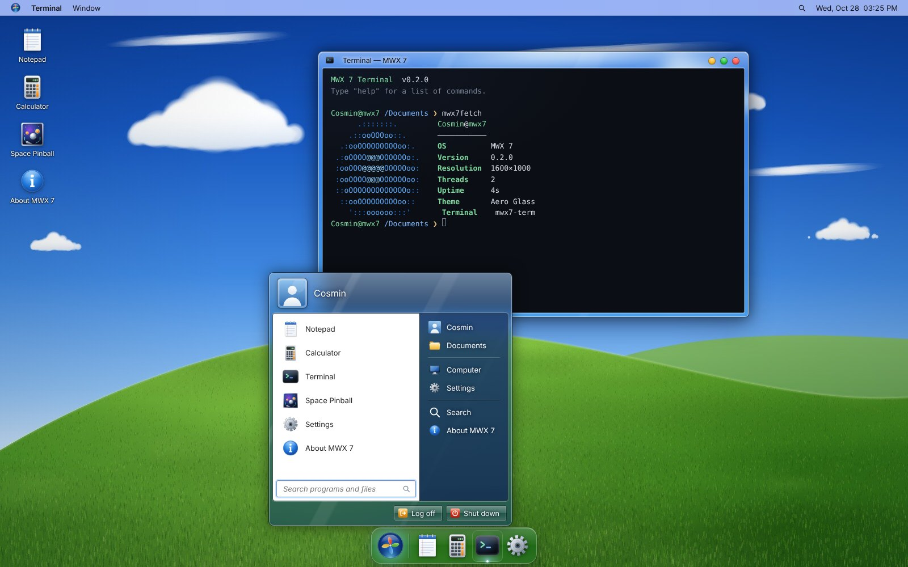
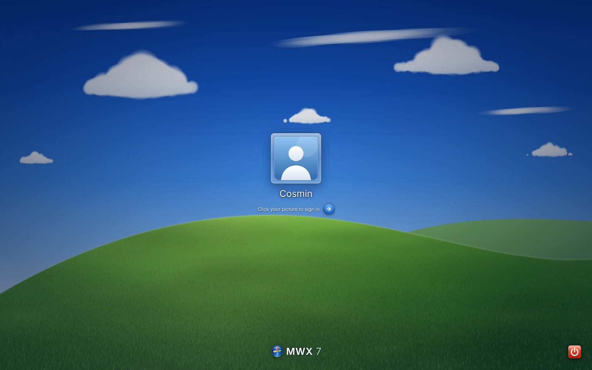

<div align="center">

# MWX 7

**The dream desktop.**

[**▶ Try it live**](https://cosminflrn.github.io/MWX7/) · v0.6 “Luna”



</div>

MWX 7 is a complete desktop operating system that runs in your browser: glass windows, a dock, a Start menu, a real boot sequence, sounds, and its own apps. No install, nothing to download. Every visit is a fresh machine: nothing is stored after you close or reload it.

## Highlights
- **A real startup.** Press the power button, watch the BIOS test your memory (with the beep), then the boot logo and the logon screen.
- **Glass everywhere.** Translucent windows, smooth animations, windows that pour into the dock when you minimize them.
- **Snap, center, full screen.** Drag a window to an edge to snap it, double-click the title bar to center it, or go full screen: the title bar melts into the top bar and the dock stretches edge to edge.
- **Start menu, Search and Overview.** Click the orb, the magnifier or the overview button in the top bar.
- **Its own sound.** Original startup chime and system sounds on real sampled instruments.
- **Living wallpapers.** Real moving footage and animated scenes, with soft ambient sound on the desktop.
- **Windows XP and 7 at heart.** My Computer, Paint, Calculator, Notepad, Aero Peek, a clock calendar and a Trash in the dock — with glossy Crystal Clear icons.
- **Apps:** My Computer, Paint, Notepad, Calculator, Space Pinball, Settings — more on the way.
- **Mouse-first.** Made for a desktop and a mouse: no touch, and no keyboard shortcuts to fight with your real OS.



## Run locally
```bash
npm install
npm run dev
```

## Contributing
Read [`SPEC.md`](SPEC.md) and [`CLAUDE.md`](CLAUDE.md). Work is tracked as GitHub issues; see [`docs/ROADMAP.md`](docs/ROADMAP.md).

## Credits
Created by Cosmin, built with Claude. Code, logo and arrangements are original; third-party media (Tango icons, Selawik font, Pexels footage and photos, FluidR3 samples) is credited in [public/media/CREDITS.md](public/media/CREDITS.md). MWX 7 is an independent project and is not affiliated with any operating system vendor.
