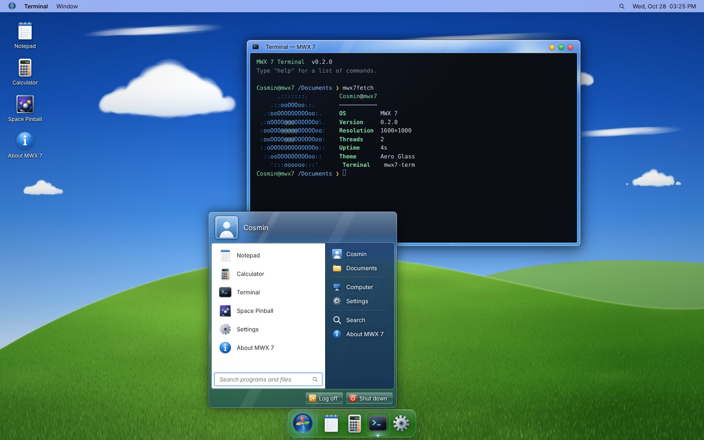
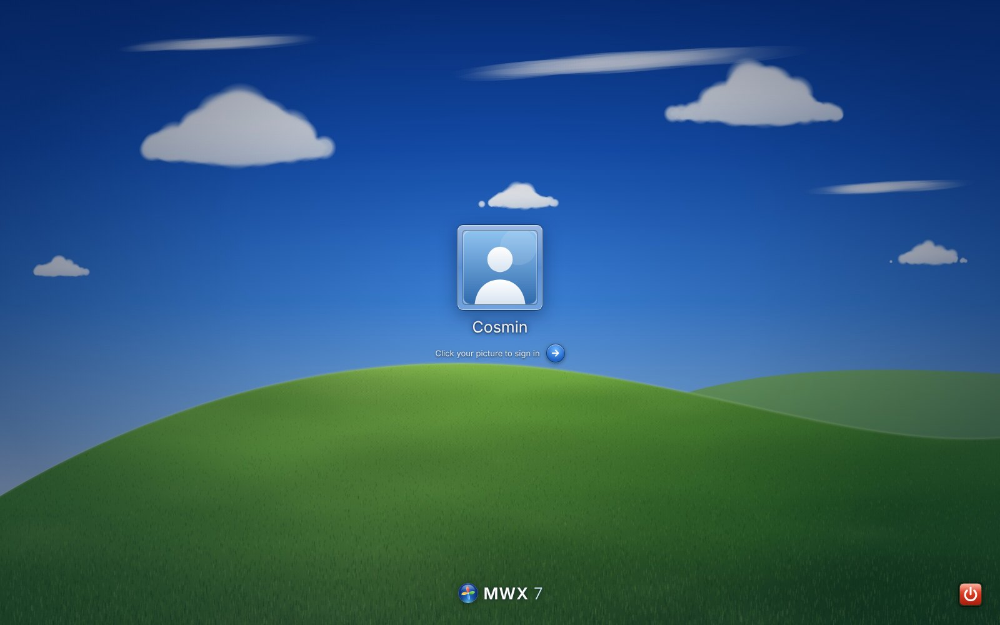

<div align="center">

# MWX 7

**The dream desktop.**

[**▶ Try it live**](https://cosminflrn.github.io/MWX7/) · v0.2 “Fidelity”



</div>

MWX 7 is a complete desktop operating system that runs in your browser: glass windows, a dock, a Start menu, a real boot sequence, sounds, and its own apps. No install, nothing to download. Your files stay in your browser.

## Highlights
- **A real startup.** Press the power button, watch the BIOS test your memory (with the beep), then the boot logo and the logon screen.
- **Glass everywhere.** Translucent windows, smooth animations, windows that pour into the dock when you minimize them.
- **Snap and center.** Drag a window to the left or right edge to snap it, to the top to maximize it, double-click the title bar to center it.
- **Start menu + Spotlight.** Click the orb or press `Ctrl+Space` to find any app or document.
- **Its own sound.** Original startup chime and system sounds, synthesized live.
- **Apps:** Notepad, Calculator, Terminal, Space Pinball, Settings — more on the way.



## Run locally
```bash
npm install
npm run dev
```

## Contributing
Read [`SPEC.md`](SPEC.md) and [`CLAUDE.md`](CLAUDE.md). Work is tracked as GitHub issues; see [`docs/ROADMAP.md`](docs/ROADMAP.md).

## Credits
Created by Cosmin, built with Claude. All artwork, sounds and code are original. MWX 7 is an independent project and is not affiliated with any operating system vendor.
