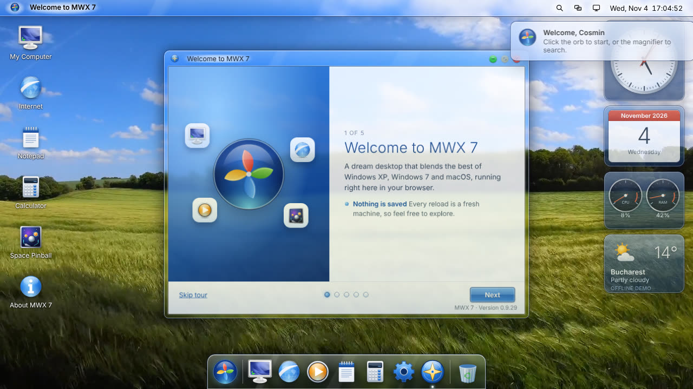
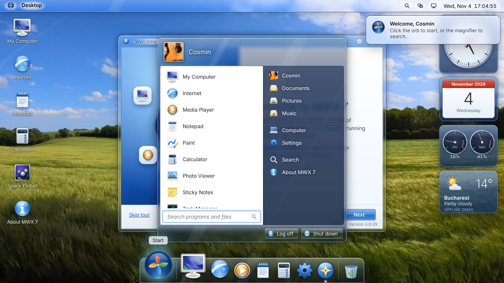
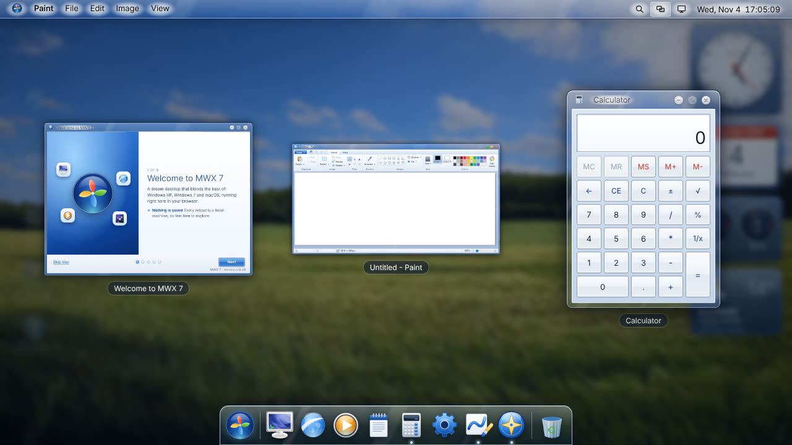
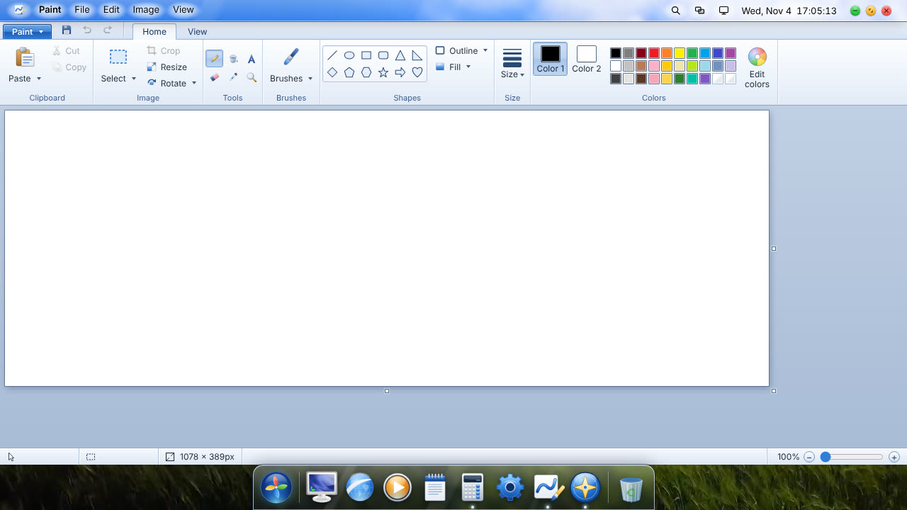

<div align="center">

# MWX 7

**The dream desktop.** A complete desktop OS that runs in your browser.

[**▶ Try it live**](https://cosminflrn.github.io/MWX7/) · [**💿 Download the OS (ISO)**](https://github.com/cosminflrn/MWX7/releases/latest) · v1.4.1 · [Changelog](CHANGELOG.md)



<video src="docs/media/demo.webm" controls muted width="720"></video>

[Animated GIF version](docs/media/demo.gif)

</div>

MWX 7 is a vanilla-TypeScript mockup operating system that blends the best of macOS, Windows XP and Windows 7: glass windows, a dock, a Start menu, a real boot sequence, original sounds and its own apps. No install, no framework, nothing stored after you close the tab: every visit is a fresh machine.

| Start menu | Overview | Full screen |
|---|---|---|
|  |  |  |

## Features

### Desktop & shell
- Power button, BIOS memory test with beep, boot logo, first-run setup and logon screen
- Glass windows with tintable blur, snap to edges, center on double-click, full screen that merges the title bar into the top bar
- Genie minimize into the dock, Aero Peek, show desktop, Overview of all windows
- Dock with a Trash, Start menu, Search, calendar flyout, notifications, desktop gadgets and icons
- MWX Commander, a DOS-style two-panel file manager

### Apps
My Computer (Explorer), Paint, Notepad, Calculator, Internet browser, Media Player, Photo Viewer, Sticky Notes, Task Manager, Settings, Welcome tour, About.

### Games
Space Pinball, Minesweeper-style Mines, Solitaire.

### Personalization
Living video and animated wallpapers with ambient sound, glass color and intensity, clock format, dock options, desktop layout, avatars.

## Run locally
```bash
npm install
npm run dev      # dev server
npm run build    # typecheck + production build
npm test         # build + end-to-end tests in Chromium
```

## Contributing
Read [`SPEC.md`](SPEC.md) and [`CLAUDE.md`](CLAUDE.md). Work is tracked as GitHub issues; see [`docs/ROADMAP.md`](docs/ROADMAP.md).

## Credits
Created by Cosmin, built with Claude. Code, logo and arrangements are original; third-party media (Tango and Crystal Clear icons, Selawik font, Pexels footage and photos, FluidR3 samples) is credited in [public/media/CREDITS.md](public/media/CREDITS.md). MWX 7 is an independent project and is not affiliated with any operating system vendor.

## License
The original code is released under the [MIT License](LICENSE). Third-party media, icons and fonts keep their own licenses (see [credits](public/media/CREDITS.md)).
